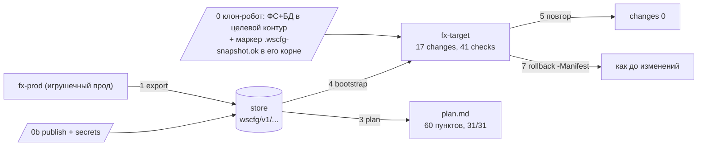

# ADMIN-START — пошаговый старт для администратора

Этот файл — маршрут «с нуля» для администратора, который видит инструмент впервые: куда
разложить папку, какую команду набрать первой и что означает каждая строчка в выводе.
[`PROCESS.md`](PROCESS.md) объясняет устройство и схемы (почему всё устроено так),
[`CONTRACTS.md`](CONTRACTS.md) — форматы и коды выхода; здесь же — только команды по буквам,
в том порядке, в котором их реально выполняют. Разделов тринадцать: 1-2 — как читать и куда
положить решение, 3-4 — подготовка машины (переменные окружения и git), 5-7 — команды по
порядку на игрушечном контуре, 8-9 — хранилище: публикация правил и секреты, 10-11 — боевой
запуск и полностью автоматический сценарий, 12-13 — поломки и чек-лист. Все команды ниже
прогнаны на игрушечном контуре и дадут те же числа, что и тестовый прогон репозитория: план
из 60 пунктов, 17 изменений, 41 проверка гейта.

## 1. Прочитай это первым

О чём это: пять правил, без которых команды из остальных разделов не заработают.

1. Команды выполняются в обычном **Windows PowerShell 5.1**: `Win+R` -> набери `powershell`
   -> Enter. Не PowerShell 7 (`pwsh`), не терминал Windows — инструмент рассчитан на 5.1.
2. Работай **из корня папки решения** (там, где лежит `README.md`). Пути к скриптам в
   командах относительные: `impl\vault\wscfg.ps1`.
3. Префикс `powershell -NoProfile -ExecutionPolicy Bypass -File ...` означает: «запусти
   вот этот скрипт, не загружая профиль и разрешив выполнение скриптов». Это одна команда,
   просто длинная.
4. Backtick (`) в конце строки — знак, что команда продолжается на следующей строке.
   Если набираешь всё одной строкой — убери backtick. Никогда не набирай саму подсказку
   вида `PS D:\...>` — она уже есть на экране.
5. Каждая команда заканчивается кодом возврата: `0` — успех, `2`..`9` — проблема.
   Проверить код сразу после команды: `echo $LASTEXITCODE`. Что означает каждый код —
   раздел 12 и [`PROCESS.md`, раздел 8](PROCESS.md).

## 2. Куда положить решение и где запускать

О чём это: одно распаковывание и одно правило про пути.

Распакуй репозиторий (клон или zip) в путь **без пробелов, кириллицы и сетевых папок**,
например: `D:\wscfg\websoft-env-promotion`. Дальше все команды — отсюда:

```powershell
cd D:\wscfg\websoft-env-promotion
dir
```

В листинге должны быть: `config`, `core`, `docs`, `impl`, `tests`, `tools` и `README.md`.
Если чего-то нет — распаковка прошла криво, переделай. Полное описание, за что отвечает
каждая папка, — «Структура репозитория» в [`../README.md`](../README.md).

Живые контуры WebSoft HCM живут **отдельно** от решения — условно
`D:\WS\prod\WebSoftServer`, `D:\WS\preprod\WebSoftServer`, `D:\WS\dev\WebSoftServer`.
Никогда не клади контур внутрь папки решения. Само решение можно держать на рабочей машине
администратора или на CI-раннере — запускающему нужен Windows PowerShell 5.1, доступ на
запись в целевой контур и доступ к хранилищу.

Решение живёт в git-репозитории: при обновлении папку не «разпаковывают заново», а делают
`git pull` перед каждой работой (как именно — раздел 4). Правила и профили, которые потом
публикуются в хранилище, — те же файлы из этого git.

## 3. Настройка переменных окружения (делается один раз)

О чём это: один раз заполнить несколько переменных на машине (или в секретах CI) — после
этого команды из остальных разделов работают без правок.

Как задавать переменную в Windows PowerShell 5.1:

```powershell
$env:VAULT_ADDR = "https://vault.internal:8200"   # только на это окно PowerShell
[Environment]::SetEnvironmentVariable("VAULT_ADDR", "https://vault.internal:8200", "Machine")
echo $env:VAULT_ADDR                              # проверка: значение видно?
```

`$env:ИМЯ = "..."` живёт до закрытия окна. `[Environment]::SetEnvironmentVariable(..., "Machine")`
— навсегда для всех (для `"Machine"` нужны права администратора; для одного пользователя —
`"User"`). `setx ИМЯ "значение"` — то же для текущего пользователя, но без возможности прочитать
значение обратно в этом окне. Любая из «навсегда» записей **не появится в уже открытых окнах** —
после неё открой PowerShell заново и проверь `echo $env:ИМЯ`. Секретные значения держи в
менеджере паролей или в секретах CI и подставляй в переменную при запуске; в `$PROFILE`, в
файлы решения и в git их не пишут.

Инструмент читает ровно эти переменные:

| переменная | где нужна | что в неё класть |
|---|---|---|
| `VAULT_ADDR` | ручной запуск и CI с Vault | адрес Vault, например `https://vault.internal:8200`. Токен задавать не нужно: он лежит в файле доступа `StoreConfig` (`Addr` + `Token` либо `RoleId` + `SecretId` для AppRole-логина), а `VAULT_TOKEN` код выставляет сам |
| `MINIO_ENDPOINT`, `MINIO_BUCKET`, `MINIO_REGION`, `MINIO_PREFIX`, `MINIO_ACCESS_KEY`, `MINIO_SECRET_KEY`, `MINIO_SECRET_KEY_FILE` | CI-пайплайн MinIO | задаются в `env`-блоке пайплайна из секретов CI и оттуда попадают в параметры шагов (`-Endpoint -Bucket -Region -Prefix -AccessKey -SecretKey -SecretKeyFile`). Сам minio-вход переменные окружения не читает — только параметры команды |
| `WSC_S3_AK`, `WSC_S3_SK` | своя машина администратора (MinIO) | удобные имена для ключей: их передают параметрами `-AccessKey $env:WSC_S3_AK -SecretKey $env:WSC_S3_SK`. Имя можешь взять своё — важно не имя, а то, что значение не светится в истории команд |
| `WSC_PSQL_EXE` | только если у цели postgres | путь к `psql.exe` (им инструмент выполняет БД-операции правил) |
| `WSC_NPGSQL_DLL` | только если у цели postgres | путь к `Npgsql.dll` |
| `WSC_SERVER_DIR_PREPROD`, `WSC_SERVER_DIR_DEV` | раннер vault-пайплайна | машинная переменная с каталогом целевого контура: пайплайн берёт `WSC_SERVER_DIR_<ENV>`, затем input-параметр, затем `contours\<env>\WebSoftServer` |
| `WSC_PROD_SERVER_DIR`, `WSC_TARGET_SERVER_DIR`, `TARGET_ENV` | раннер minio-пайплайна | `WSC_PROD_SERVER_DIR` — каталог прода-источника (откуда снимают baseline) и `WSC_TARGET_SERVER_DIR` — каталог целевого контура, обе машинные; `TARGET_ENV` — имя целевого контура, его пайплайн подставляет сам из матрицы |

Про доступ к БД — отдельно, потому что это чаще всего путают: отдельных переменных с логином
и паролем базы **нет**. Драйвер и строка соединения берутся из конфига **самого целевого
контура** (`spxml_unibridge_config.xml` — `DBType` и `ConnectionString`, `xHttp.ini` —
каталог-хранилище), а `PGPASSWORD` на время БД-операций код подставляет сам из этой строки.
Для MSSQL и filexml переменных не нужно вообще; `WSC_PSQL_EXE`/`WSC_NPGSQL_DLL` задают один раз
на postgres-цели — и это единственные «переменные БД» в инструменте.

> Переменных, которых нет в этой таблице, инструмент не читает. Совет «добавь ещё одну
> переменную» из другого проекта сюда не переносится: если после команды что-то не работает,
> ищи причину в параметрах команды и в коде выхода (раздел 12), а не в новой переменной.

## 4. Git: где живут правила и зачем он нужен

О чём это: git — «оригинал документов», хранилище — «распечатанные копии».

Правила и профили — обычные текстовые файлы в git-репозитории решения:
`config\overlays\<env>\rules.json`, `config\overlays\<env>\profile.json` и обязательный реестр
`config\mandatory.registry.json`. Хранилище (Vault или MinIO) содержит **опубликованную копию**
правил и профиля, а контур получает то, что опубликовано. Поэтому правка всегда идёт так:
изменил файл в git -> проверил `validate` -> отправил в git -> опубликовал в хранилище
`edit -Set` (раздел 8). Править «копию» в хранилище руками нельзя; править конфиги в самом
контуре бессмысленно — следующий `apply` перетрёт их правилом.

Первый раз на машине (нужен установленный git и доступ к репозиторию решения):

```powershell
git clone <URL репозитория> D:\wscfg\websoft-env-promotion
cd D:\wscfg\websoft-env-promotion
```

Дальше — каждая рабочая сессия (в блоке только команды, без вывода):

```powershell
git pull
notepad config\overlays\preprod\rules.json
git status
git diff
powershell -NoProfile -ExecutionPolicy Bypass -File impl\vault\wscfg.ps1 -Command validate -Env preprod
git add config/overlays/preprod/rules.json
git commit -m "preprod: правило aihub-токен берём из секрета"
git push
```

Порядок важен: `validate` (раздел 5) проверяет файлы git — схему правил, покрытие реестра,
отсутствие прод-значений — **до** `git push`, а контур ничего из этого ещё не видит: он живёт
по хранилищу, и публикация — отдельный шаг (раздел 8).

Как вернуть правило назад:

```powershell
git log --oneline -- config/overlays/dev/rules.json
git revert <commit>
```

`git revert` отменяет правку в git-файле; в хранилище правило само не меняется — после revert
его надо опубликовать заново (`edit -Set` с актуальной `-ExpectedVersion`, раздел 8).

В git никогда не кладут: файл доступа `StoreConfig` с токеном (держи вне папки решения,
например `C:\secrets\wscfg-vault-preprod.json`, или в секретах CI — `.gitignore` его не
спасёт), значения секретов (раздел 9), маркер `.wscfg-snapshot.ok` (он лежит в целевом
контуре). Локальный кэш снимков `config\baseline\`, бэкапы `.wscfg-backup\` и `*.log` уже
исключены `.gitignore`; `config\overlays\` намеренно версионируется — это и есть редактируемый
администратором источник истины.

## 5. Первая команда за 5 минут (без серверов)

О чём это: самая безопасная команда решения — `validate`; она ничего не меняет и хранилища
не требует.

```powershell
powershell -NoProfile -ExecutionPolicy Bypass -File impl\vault\wscfg.ps1 -Command validate -Env dev
```

Разбор по частям:

| кусок команды | что значит |
|---|---|
| `powershell` | сам интерпретатор Windows PowerShell 5.1 |
| `-NoProfile -ExecutionPolicy Bypass` | не грузить профиль; разрешить этот скрипт |
| `-File impl\vault\wscfg.ps1` | тонкий вход Vault (есть зеркальный `impl\minio\wscfg.ps1`) |
| `-Command validate` | имя команды: проверить правила и покрытие реестра |
| `-Env dev` | по правилам какого контура проверять |

Ожидаемый вывод: последняя строка `exit=0`. Команда сверяет схему правил, покрытие
реестра обязательных ключей (31 ключ) и отсутствие прод-значений/`**REDACTED**` в `config/**`.
`-Env preprod` — та же команда для правил preprod: правила у каждого контура свои
(`config\overlays\<env>\`), поэтому результат по контурам может отличаться.
Провал — `exit=3`: читай последнюю строку с `[WSC_...]` и [`PROCESS.md`, раздел 8](PROCESS.md);
чаще всего для какого-то ключа реестра нет правила в `rules.json`.

## 6. Игрушечный контур и хранилище-папка

О чём это: учимся на подставном контуре и папке вместо Vault/MinIO — ничего не сломать.

Игрушечный контур делает тестовая фикстура. Она **не запускается напрямую** — это набор
функций, их сначала «подключают» точкой в начале строки (dot-source), потом вызывают:

```powershell
. .\tests\fixture\New-FixtureContour.ps1
New-FixtureContour -OutDir "D:\wscfg\sandbox\fx" -Name fx-prod
New-FixtureContour -OutDir "D:\wscfg\sandbox\fx" -Name fx-target
```

Получатся два одинаковых маленьких контура: `D:\wscfg\sandbox\fx\fx-prod\WebSoftServer`
(изображаем прод) и `...\fx-target\WebSoftServer` (куда переносим). Внутри: пять корневых
конфигов (`xHttp.ini`, `spxml_unibridge_config.xml`, `xhttp_config.json`,
`mediasoup_config.json`, `components_platform_config.json`), компонент `platform\`,
данные-как-файлы `wt_data\`, заглушка сервера `xhttp_launcher.cmd` и
`wt\web\verify.html`. В прод-значениях сидят маркеры вроде `prod-db.internal` — на них
потом проверяется, что прод не протёк в dev.

Хранилищем может быть **обычная папка** — файловый «фейк» вместо Vault/MinIO: вместо
`-StoreConfig <файл-доступа>` пишешь `-StoreRoot <каталог>` (у minio-входа ещё
`-Transport fake`). Схема путей внутри та же, что в живом хранилище
(`wscfg/v1/...`, см. [`../impl/vault/layout.md`](../impl/vault/layout.md)).

Дальше — подготовка (делается один раз для песочницы). Инструмент переносит только конфиг, а
данные (файловая система + дамп БД) в целевой контур кладёт клон-робот внешней инфраструктуры,
и инструмент требует подтверждение этого — файл-маркер `.wscfg-snapshot.ok` в **корне**
целевого контура. Клон-робота в песочнице нет, поэтому нулевой шаг делаем руками: `New-Item`
ниже в корень `fx-target` — это имитация шага 0 (раздел 7); на живом контуре руками ставить
маркер не надо.

```powershell
New-Item -ItemType File -Path "D:\wscfg\sandbox\fx\fx-target\WebSoftServer\.wscfg-snapshot.ok"
```

Теперь в хранилище-папку публикуем правила и профиль (файлы лежат в git, см. раздел 8) и
записываем три секрета, которых требуют dev-правила (раздел 9):

```powershell
$prod  = "D:\wscfg\sandbox\fx\fx-prod\WebSoftServer"
$tgt   = "D:\wscfg\sandbox\fx\fx-target\WebSoftServer"
$store = "D:\wscfg\sandbox\store"
$cfg   = "D:\wscfg\websoft-env-promotion\config\overlays\dev"

powershell -NoProfile -ExecutionPolicy Bypass -File impl\vault\wscfg.ps1 -Command edit `
  -Env dev -Item rules -Set -SourceFile "$cfg\rules.json" -StoreRoot $store
powershell -NoProfile -ExecutionPolicy Bypass -File impl\vault\wscfg.ps1 -Command edit `
  -Env dev -Item profile -Set -SourceFile "$cfg\profile.json" -StoreRoot $store

$env:WSC_TMP = "Server=dev-db.internal;Database=wt_data;User Id=wt;Password=dev-secret"
powershell -NoProfile -ExecutionPolicy Bypass -File impl\vault\wscfg.ps1 -Command edit `
  -Env dev -Item secret:dev__db_connection_string -Set -Value $env:WSC_TMP -StoreRoot $store
$env:WSC_TMP = "dev-secret"
powershell -NoProfile -ExecutionPolicy Bypass -File impl\vault\wscfg.ps1 -Command edit `
  -Env dev -Item secret:dev__db_password -Set -Value $env:WSC_TMP -StoreRoot $store
$env:WSC_TMP = "sk-dev-0123456789"
powershell -NoProfile -ExecutionPolicy Bypass -File impl\vault\wscfg.ps1 -Command edit `
  -Env dev -Item secret:dev__aihub_credentials_token -Set -Value $env:WSC_TMP -StoreRoot $store
$env:WSC_TMP = $null
```

Каждая команда — `exit=0`. Хранилище готово, можно идти по маршруту.

## 7. Полный путь на игрушечном контуре

О чём это: восемь шагов «прод -> целевой контур» (шаги 0..7) руками, с ожидаемым выводом на
каждом шаге. Пути `$prod`, `$tgt`, `$store` из раздела 6 должны быть заданы в этом же окне.



ASCII-дубль:

```
0 клон-робот: ФС+БД -> fx-target + маркер .wscfg-snapshot.ok в корне (песочница - New-Item, раздел 6)
fx-prod --1 export--> store(wscfg/v1) --3 plan--> plan.md (60 пунктов)
0b publish rules/profile + 3 secrets --> store        |
store + fx-target --4 bootstrap -NoStart--> fx-target (17 changes, 41 checks)
                              --5 повтор-------> changes 0
fx-target --7 rollback -Manifest--> состояние до изменений
```

| # | шаг | зачем (бытово) | команда | что увидите |
|---|---|---|---|---|
| 0 | перенос данных | данные в целевом контуре + маркер-подтверждение в его **корне** | клон-робот (в песочнице — `New-Item` из раздела 6) | `.wscfg-snapshot.ok` в корне контура |
| 1 | export | снять снимок прод-конфига в хранилище | см. ниже | `exit=0` |
| 2 | diff | посмотреть, чем целевой контур отличается от снимка | см. ниже | `exit=0`, список расхождений |
| 3 | plan | посчитать, что станет с целевым контуром, ничего не меняя | см. ниже | `plan\plan.md`, `exit=0` |
| 4 | apply (bootstrap) | применить изменения по-настоящему | см. ниже | `exit=0`, отчёт в `-OutDir` |
| 5 | повтор apply | проверить, что второй раз менять нечего | команда шага 4 | `exit=0`, `changes: []` |
| 6 | отчёт | прочитать, что именно поехало | открыть `apply-report.md` | `changes: 17` |
| 7 | rollback | вернуть контур как до изменений | см. ниже | `exit=0` |

**Шаг 0 — перенос данных.** Инструмент переносит только конфиг. Файловую систему и дамп БД из
прода в целевой контур кладёт клон-робот внешней инфраструктуры, и по завершении он сам создаёт
файл-маркер `<ServerDir>\.wscfg-snapshot.ok` — в **корне** целевого контура (например
`D:\WS\preprod\WebSoftServer\.wscfg-snapshot.ok`), а не в `wt\web`. В песочнице его эмулирует
`New-Item` из раздела 6. Пока маркера нет, bootstrap считает контур неподготовленным и
останавливается на preflight (`exit=2`).

**Шаг 1 — export.** «Ксерокопия» прод-конфига в хранилище; секретные значения там
заменяются на `**REDACTED**`, никогда не улетают в снимок. Локальная копия снимка кладётся
в кэш `config\baseline\`.

```powershell
powershell -NoProfile -ExecutionPolicy Bypass -File impl\vault\wscfg.ps1 -Command export `
  -ServerDir $prod -StoreRoot $store
```

MinIO-вход — только с другим источником и флагом фейка:

```powershell
powershell -NoProfile -ExecutionPolicy Bypass -File impl\minio\wscfg.ps1 -Command export `
  -SourceServer $prod -Transport fake -StoreRoot $store
```

**Шаг 2 — diff.** «Сверка витрины»: чем текущий целевой контур отличается от прод-снимка.

```powershell
powershell -NoProfile -ExecutionPolicy Bypass -File impl\vault\wscfg.ps1 -Command diff `
  -Env dev -ServerDir $tgt -StoreRoot $store
```

(MinIO: добавить `-Transport fake`.) До применения отличия — это те самые прод-маркеры,
которые правила обещают убрать.

**Шаг 3 — plan.** Компилятор правил: берёт baseline из хранилища, правила/профиль из
`config\overlays\dev` и реестр, пишет `plan.json` + `plan.md`.

```powershell
powershell -NoProfile -ExecutionPolicy Bypass -File impl\vault\wscfg.ps1 -Command plan `
  -Env dev -ServerDir $tgt -OutDir "D:\wscfg\sandbox\out\plan" -StoreRoot $store
```

Открой `D:\wscfg\sandbox\out\plan\plan.md`: `Coverage` — `registryTotal: 31`,
`covered: 31`, `missing: none` (пустой `missing` — обязательно, иначе прогон не пустят);
`## Changes (60)` — 60 пунктов плана; `planHash: sha256:ef639670...`. Значения секретов в
`plan.md` показаны как `<secret:имя>` — так и задумано, ценность не светится в отчётах.

**Шаг 4 — apply через bootstrap.** Полная обёртка: preflight -> plan -> backup -> apply ->
verify-гейт. Тонкая команда `apply` секреты из хранилища не подставляет (значения-ценности
умеет подставлять только `bootstrap`), поэтому apply — всегда через bootstrap:

```powershell
impl\vault\bootstrap.cmd -ServerDir $tgt -Env dev -StoreRoot $store `
  -OutDir "D:\wscfg\sandbox\out\bp1" -NoStart
```

`-NoStart` — не поднимать сервер после применения (в песочнице поднимать нечего; на живом
контуре его не ставят и bootstrap ждёт `verify.html`, раздел 10). Файлы в `-OutDir`:
`plan.md`, `apply-report.json`, `apply-report.md`, `bootstrap.log`. В `apply-report.md`:
`changes: 17`, `verify` — 41 проверка. В `bootstrap.log`: `preflight ok`,
`plan ok items=60`, `apply ok changes=17`, `exit=0`.
MinIO — свой bootstrap с фейк-хранилищем:

```powershell
powershell -NoProfile -ExecutionPolicy Bypass -File impl\minio\bootstrap.ps1 `
  -ServerDir $tgt -Env dev -Transport fake -StoreRoot $store `
  -OutDir "D:\wscfg\sandbox\out\mbp1" -NoStart
```

**Шаг 5 — повтор apply.** Та же команда шага 4, только `-OutDir` — `out\bp2`. Ожидание:
`exit=0`, а в `out\bp2\apply-report.json` — `"changes": []`. Это идемпотентность: повторно
менять нечего.

**Шаг 6 — читать apply-report.md.** Секции: `Contour` (куда применили, `planHash`),
`Rules` (`changes: 17` — сколько правил реально что-то поменяли), список изменений по
`rule id` и результат verify-гейта. Формат файла — [`CONTRACTS.md`](CONTRACTS.md).

**Шаг 7 — rollback.** Контур «до изменений» лежит в backup внутри контура:

```powershell
dir "$tgt\.wscfg-backup"
powershell -NoProfile -ExecutionPolicy Bypass -File impl\vault\wscfg.ps1 -Command rollback `
  -Manifest "$tgt\.wscfg-backup\<id>\manifest.json"
```

`<id>` — имя каталога из `dir` (guid). Хранилище для отката не нужно, `-ServerDir` тоже
(он зашит в манифест). Откат побайтово возвращает файлы (на тестовом контуре — 18 файлов)
и делает обратные БД-операции; раскатка по шагам — [`PROCESS.md`, раздел 9](PROCESS.md).

## 8. edit: правила, профиль и секреты в хранилище

О чём это: `edit` — единственная команда, которой открывают «шкаф» (хранилище): прочитать
правила или профиль, опубликовать их правку, записать секрет.

Хранилище — «шкаф с папками `wscfg/v1/...`»: `baseline/` (снимок прода), `overlays/`
(правила и профиль по контурам), `secrets/` (секреты). Правила и профиль живут в git
(`config\overlays\<env>\rules.json`, `profile.json` — раздел 4) и **публикуются** в хранилище
командой `edit` — в хранилище их править руками нельзя. Секреты в git не живут вообще: их в
хранилище только записывают той же командой (раздел 9).

Формула одна — меняется только `-Item` и ключевое слово действия:

```powershell
powershell -NoProfile -ExecutionPolicy Bypass -File impl\vault\wscfg.ps1 -Command edit `
  -Env <env> -Item <rules|profile|secret:ключ> (-Get | -Set) <данные> <параметры хранилища>
```

| `-Item` | что даёт `-Get` | чем пишут `-Set` |
|---|---|---|
| `rules` | текст правил (`Text`) и `Version` | `-SourceFile <файл>` — опубликовать файл из git |
| `profile` | то же для профиля контура | `-SourceFile <файл>` |
| `secret:<ключ>` | `Value` — **открытое значение секрета** | `-Value <значение>` |

Параметры: `-ExpectedVersion <N>` подключает защиту от перезаписи (CAS, ниже). `-Json` печатает
ответ в конверте (`ExitCode` + `Result`), без него — только содержимое (`Text`/`Version` после
чтения, `Path`/`Version` после записи). Действие указывают одно: если написать `-Get` и `-Set`
сразу, команда только прочитает и ничего не опубликует. Правила проверяются на схему в момент
публикации, поэтому битые правила в хранилище не появятся: публикация упадёт с `exit=3`. В
примерах ниже `$store` и `$cfg` из раздела 6; живое хранилище вместо `-StoreRoot $store` требует
`-StoreConfig <файл-доступа>` (Vault) либо `-Transport rest -Endpoint ... -AccessKey ...
-SecretKey ...` (MinIO).

**Пример 1 — прочитать правила** (что лежит в хранилище прямо сейчас):

```powershell
powershell -NoProfile -ExecutionPolicy Bypass -File impl\vault\wscfg.ps1 -Command edit `
  -Env dev -Item rules -Get -Json -StoreRoot $store
```

Ответ — `Text` (текст правил) и `Version` (номер версии), `exit=0`. Номер версии запоминаем: он
нужен при публикации.

**Пример 2 — опубликовать правила** после правки файла в git:

```powershell
powershell -NoProfile -ExecutionPolicy Bypass -File impl\vault\wscfg.ps1 -Command edit `
  -Env dev -Item rules -Set -SourceFile "$cfg\rules.json" `
  -ExpectedVersion 1 -StoreRoot $store
```

`exit=0`, в ответе — `Path` (куда легло, `wscfg/v1/overlays/dev/rules.json`) и новая `Version`.
Первая публикация в свежее хранилище идёт без `-ExpectedVersion` (там ещё ничего нет); тут он
указан, потому что по примеру 1 в хранилище уже лежит версия 1.

**Пример 3 — записать секрет** (значение берём из переменной, а не из истории команд):

```powershell
$env:WSC_TMP = "dev-secret"
powershell -NoProfile -ExecutionPolicy Bypass -File impl\vault\wscfg.ps1 -Command edit `
  -Env dev -Item secret:dev__db_password -Set -Value $env:WSC_TMP -StoreRoot $store
$env:WSC_TMP = $null
```

**Пример 4 — проверить, что секрет на месте** (команда печатает значение открытым):

```powershell
powershell -NoProfile -ExecutionPolicy Bypass -File impl\vault\wscfg.ps1 -Command edit `
  -Env dev -Item secret:dev__db_password -Get -Json -StoreRoot $store
```

Признак, что секрет есть, — `exit=0`; нет секрета — `exit=7`. Значение при этом печатается
в консоль открытым, так что вывод не сохраняй в лог, не вставляй в тикет и не делай скриншот.

Все четыре команды из примеров дают `exit=0`; `dev__db_password` — имя секрета из `rules.json`
(раздел 9). После публикации не забудь закоммитить и отправить в git сам файл (раздел 4).
Теперь про номер версии — он защищает от перезаписи.

CAS бытовым языком: `Version` — номер бланка в шкафу. Публикуя, ты называешь номер, с
которого переписывал (`-ExpectedVersion 1`). Если пока ты печатал, бланк уже подменили
(версия в шкафу другая), шкаф откажет: `cas conflict`, `exit=7` — так два администратора не
затирают правки друг друга. Прочитал `-Get` -> версия `2` -> публикуешь с
`-ExpectedVersion 2`.

Два провала, которые бывают именно на `edit`:

- `exit=7` — хранилище недоступно **или** объекта в нём ещё нет. В свежем хранилище первый
  `-Get` падает именно так: читать нечего. Порядок для нового хранилища — сначала публикация
  `-Set` (без `-ExpectedVersion`), и только потом `-Get`. Если объект есть, но версия не та,
  в выводе будет `cas conflict`: перечитай `-Get`, перенеси свою правку на актуальный текст и
  публикуй с новой `-ExpectedVersion`.
- `exit=9` — неверные аргументы: опечатка в `-Item` (неизвестный вид вроде `rules2` или `secret`
  без ключа после двоеточия), опечатка в имени параметра.
- `exit=3` — публикация правил, которые не проходят схему: файл правится, а не публикуется.
- Ловушка, которая НЕ выглядит как ошибка: `-SourceFile` у секрета принимается и `exit=0`, но в
  хранилище ложится **текст файла** как значение секрета. Для секрета значение передают только
  `-Value`; если уже записал не то — перезапиши `-Value`, версия просто вырастет на 1.

Никогда не правь конфиги «на сервере» руками: такое изменение не попадёт ни в git, ни в
baseline, и следующий `apply` молча перетрёт его правилом. Типовые истории про это —
[`PROCESS.md`, раздел 12](PROCESS.md).

## 9. Секреты

О чём это: в документе лежит только имя сейфа, ценность — в сейфе.

Правило вида `action: "secret"` хранит **имя** секрета (например
`dev__aihub_credentials_token`), а значение живёт только в хранилище. На `apply` значение
подставляет в файл/БД bootstrap. В git, в baseline (`export`) и в отчётах (`plan.md`,
`apply-report.md`) значение не появляется никогда.

Запись секрета — только `edit`, значение лучше брать из переменной окружения, а не из
истории команд:

```powershell
$env:WSC_NEW_SECRET = (Read-Host -AsSecureString) # или значение из вашего хранилища паролей
powershell -NoProfile -ExecutionPolicy Bypass -File impl\vault\wscfg.ps1 -Command edit `
  -Env dev -Item secret:dev__aihub_credentials_token -Set -Value $env:WSC_NEW_SECRET `
  -StoreRoot $store
```

Для dev-правил нужно ровно три секрета: `dev__db_connection_string`, `dev__db_password`,
`dev__aihub_credentials_token`. Имена берутся из `rules.json` (поле `secret`), префикс
`secret:` в `-Item` обязателен. Чтение (для проверки, что значение вообще есть):
`-Item secret:<ключ> -Get`.

> MinIO: секрет в бакете хранится только в зашифрованном виде (age или AES-обёртка
> `WSCEF1:`), ключ шифрования — отдельный секрет CI. Открытое значение в хранилище —
> фатальная ошибка даже на `validate`. Подробности —
> [`../impl/minio/layout.md`](../impl/minio/layout.md), у Vault —
> [`../impl/vault/layout.md`](../impl/vault/layout.md).

## 10. Боевой запуск на настоящем контуре

О чём это: один прогон bootstrap на живом контуре и как читать его вывод.

Файл доступа к хранилищу (`StoreConfig`) даёт администратор Vault (у MinIO — эндпоинт,
бакет и ключи). `SecretId` (одноразовый ключ Vault) — только в секреты CI или в
переменную окружения, никогда не в git и не в файл проекта.

Чек-лист целевого контура перед прогоном (это проверяет и preflight, но с него лучше
начать руками):

- процессы `xhttp_64`, `xhttp_launcher`, `dotnetcore` остановлены;
- переменные окружения настроены (раздел 3), а правила и профиль опубликованы из свежего git
  (разделы 4 и 8);
- клон-робот по завершении клонирования создал маркер `.wscfg-snapshot.ok` в **корне** контура:
  проверь наличие и свежесть (`dir "D:\WS\preprod\WebSoftServer\.wscfg-snapshot.ok"`, посмотри
  `LastWriteTime`) — руками его ставить не надо. Если данные переносил ты сам, тогда и маркер
  ставишь ты, иначе bootstrap решит, что контур не готов (`exit=2`);
- в корне контура есть launcher (`xhttp_launcher.cmd` или `xhttp_launcher.exe`);
- здоровье сервера — появление файла `verify.html` в корне контура (проверяется каждые
  250 мс до `-HealthTimeoutSec`, по умолчанию 120); это НЕ http-запрос.

Прогон целиком (из корня решения; доступ из `C:\secrets\...` — пример):

```powershell
impl\vault\bootstrap.cmd -ServerDir "D:\WS\preprod\WebSoftServer" -Env preprod `
  -StoreConfig "C:\secrets\wscfg-vault-preprod.json" -OutDir ".\out\preprod"
```

Как читать вывод (`bootstrap.log` и последние строки консоли):

```
preflight ok for env preprod   <- контур готов, хранилище читается
plan ok items=N                <- план собран (на игрушечном контуре items=60)
apply ok changes=M             <- применено (на игрушечном — 17)
health probe passed            <- сервер поднялся и показал verify.html
exit=0
```

Числа на живом контуре другие — структура вывода та же. Провал любой стадии прерывает
прогон, а после `apply` при неудаче работает авто-откат.

> MinIO: defaults другие (`-Transport rest`, `-Bucket websoft-configs`, `-Region
> us-east-1`, `-Prefix wscfg/v1`, `-HealthTimeoutSec 60`), здоровье — `wt\web\verify.html`
> или корень, опционально HTTP-проба `-HealthUrl`; preflight дополнительно проверяет
> раскладку контура, свободные ≥200 МБ и маркер снимка **в хранилище**. Пайплайн CI
> состоит из двух задач (`plan` -> `ручной апрув` -> `apply`), апрув — точная строка
> `APPROVE-preprod`, иначе `exit=9`; артефакты включают `bootstrap-report.json`.
> Конвейер Vault — одна задача с environment-апрувом (required reviewer).

Запуск через CI и схема конвейера — [`PROCESS.md`, разделы 6 и 7](PROCESS.md), файлы
пайплайнов: [`impl/vault/pipeline/gitea-promote-prod-to-preprod.yml`](../impl/vault/pipeline/gitea-promote-prod-to-preprod.yml)
и [`impl/minio/pipeline/gitea-promote-prod-to-preprod.yml`](../impl/minio/pipeline/gitea-promote-prod-to-preprod.yml).
Прогон совсем без тебя — раздел 11; если что-то упало — раздел 12.

## 11. Полностью автоматический сценарий (без администратора)

О чём это: цепочка «клон-робот -> маркер -> bootstrap», в середине которой нет человека.

Выглядит так: клон-робот переносит ФС+БД из прода в целевой контур и создаёт
`.wscfg-snapshot.ok` в его корне -> по расписанию (или по сигналу от клона) запускается
bootstrap и сам проходит plan -> backup -> apply -> verify-гейт -> health-пробу -> отчёт.
Человека внутри цепочки нет, если выполнены предпосылки:

- правила и профиль опубликованы в хранилище (`edit -Set`, раздел 8) и проходят `validate`;
- нужные секреты в хранилище (раздел 9);
- на исполнителе есть доступ к хранилищу: файл `StoreConfig` (Vault) либо эндпоинт и ключи
  (MinIO) — и то и другое живёт вне git (разделы 3 и 4);
- переменные окружения заданы (раздел 3), каталог целевого контура известен заранее;
- процессы контура (`xhttp_64`, `xhttp_launcher`, `dotnetcore`) остановлены — это обязанность
  того, кто готовит контур к прогону: клон-робот перед копированием данных или ты руками.

**Вариант CI (Gitea Actions).** Штатные пайплайны запускаются `workflow_dispatch` — «по
кнопке» из интерфейса CI, то есть планировщик должен уметь дёргать запуск по API:

- Vault — одна задача, апрув сделан `environment` с required reviewer. Чтобы цепочка шла без
  человека, в настройках Gitea (Environments -> нужное окружение) снимают required reviewers;
  путь целевого контура берётся из машинной переменной раннера `WSC_SERVER_DIR_<ENV>`, адрес
  Vault — из секрета `VAULT_ADDR`;
- MinIO — две задачи (`plan` -> `apply`), между ними шаг-гейт, который сверяет input-параметр
  `approve` с точной строкой `APPROVE-<env>` и при несовпадении даёт `exit=9`. Планировщик
  передаёт эту строку тем же параметром (`APPROVE-preprod`) и ставит `dry_run_only=false`;
  источник снимка задаёт параметром `source_server` либо машинной `WSC_PROD_SERVER_DIR`;
- запуск по расписанию — `on: schedule` (cron) в том же yml, если self-hosted-раннер CI
  поддерживает планировщик; иначе запускай `workflow_dispatch` из планировщика машины.

Артефакты прогона (шаги upload-artifact): `plan.json`, `plan.md`, `apply-report.json`,
`apply-report.md`, `bootstrap.log`; у MinIO дополнительно `bootstrap-report.json` и манифесты
отката. Именно их читает ответственный за автоматический прогон — уже после факта.

**Вариант без CI: «Планировщик заданий» Windows.** Задача, которая в нужное время выполняет
обёртку из корня решения:

```
Программа:      D:\wscfg\websoft-env-promotion\impl\vault\bootstrap.cmd
Аргументы:      -ServerDir D:\WS\preprod\WebSoftServer -Env preprod -StoreConfig C:\secrets\wscfg-vault-preprod.json -OutDir D:\wscfg\out\preprod
Рабочая папка:  D:\wscfg\websoft-env-promotion
```

Код возврата задачи равен коду выхода из [`CONTRACTS.md`](CONTRACTS.md) (`bootstrap.cmd` —
обёртка над `bootstrap.ps1`, он его отдаёт как есть), поэтому мониторинг реагирует на ненулевой
код, не читая логов. Для MinIO — та же схема с `impl\minio\bootstrap.ps1` и параметрами
хранилища (`-Transport rest -Endpoint ... -Bucket ... -Region ... -Prefix ... -AccessKey ...
-SecretKey ...`, вместо ключей можно `-SecretKeyFile ...`). Флаг `-Snapshot -SourceServer <прод>`
добавляет снятие baseline в начало того же прогона: это `export` конфига в хранилище, а не
перенос ФС+БД, — данные всё так же кладёт клон-робот (шаг 0 из раздела 7).

Что гарантирует безопасность без человека: verify-гейт (41 проверка на игрушечном контуре),
health-проба по `verify.html` и авто-откат при провале любой стадии после `apply`. Чего гарантии
НЕ дают: смысл правки правил никто не перечитывает — гейт проверяет форму, покрытие реестра и
состояние контура, а не «то ли это правило, которое хотел заказчик». Штатная поставка
сознательно ставит ручной апрув, и его снятие — осознанное решение владельца контура; проверка
`apply-report.md` пост-фактум (раздел 13) после этого обязательна.

## 12. Если что-то сломалось

О чём это: три первых действия и мини-навигация по кодам выхода.

1. Прочитай **последнюю строку с `[WSC_...]`** — в ней уже написано, что случилось и где.
2. Открой `bootstrap.log` в `-OutDir` — видно, на какой стадии всё встало.
3. Не повторяй прогон, не поняв причину: `apply` с провалом сам делает авто-откат, но
   причина обычно в правилах/секретах, и повтор её не уберёт.

Коды выхода (полная таблица с действиями — [`PROCESS.md`, раздел 8](PROCESS.md);
формально — [`CONTRACTS.md`, раздел 0.1](CONTRACTS.md)):

- `2` — контур не готов (процессы, маркер, нет места, нет доступа на запись);
- `3` — проверка правил не прошла: план не собрался (нет правила для обязательного ключа, нет
  секрета в хранилище) либо публикация правил со сломанной схемой (раздел 8);
- `4` — применение упало (обычно с авто-откатом);
- `5` — verify-гейт (контур после изменений не прошёл проверки — авто-откат);
- `6` — сервер не поднялся / нет `verify.html` за `-HealthTimeoutSec`;
- `7` — хранилище недоступно или `cas conflict` (версию подменили — перечитай `-Get`);
- `8` — попытка тронуть подписанное (`platform/`, `components/`);
- `9` — неверные аргументы команды (опечатка в параметре).

Ручной откат после успешного apply:

```powershell
powershell -NoProfile -ExecutionPolicy Bypass -File impl\vault\wscfg.ps1 -Command rollback `
  -Manifest "D:\WS\preprod\WebSoftServer\.wscfg-backup\<id>\manifest.json"
```

`-Manifest` — единственный обязательный параметр; хранилище не нужен, на обоих входах
(Vault и MinIO) одинаково.

## 13. Чек-лист на каждый день

О чём это: что делать до прогона, на апруве и после.

**До прогона:**

- маркер `.wscfg-snapshot.ok` в корне целевого контура создан клоном-роботом и свежий
  (раздел 10);
- переменные окружения на месте (раздел 3), решение перед работой обновлено `git pull`
  (раздел 4);
- `export` прод-контура свежий (после последнего изменения прода);
- `diff` по целевому контуру просмотрен и понятен;
- `plan`: `coverage` пустой (`missing: none`), `plan.md` прочитан человеком, `planHash`
  зафиксирован в задаче/апруве;
- нужные секреты в хранилище есть (иначе план прогона все равно упадёт на apply).

**Апрув:** изменения целевого контура подтверждает ответственный за контур — в Vault-CI
это environment с required reviewer, в MinIO-CI — точная строка `APPROVE-<env>` в ручном
шаге. Апрув «на глаз, не читая plan.md» — не апрув.

**После прогона:**

- в `apply-report.md` посмотреть `changes` и verify-секцию; артефакты CI (`plan.json`,
  `apply-report.*`, `bootstrap.log`) остались в задаче;
- контур проверен штатной проверкой (портал/логин), сервер поднят;
- любое расхождение — в FAQ [`PROCESS.md`, раздел 12](PROCESS.md);
- если прогон шёл без администратора (раздел 11), `apply-report.md` читают пост-фактум: до
  записи в контур отчёт никто не видел.

Словарь терминов (baseline, правило, профиль, CAS, verify-гейт) —
[`PROCESS.md`, раздел 2](PROCESS.md); рецепты на каждый день —
[раздел 6](PROCESS.md); форматы файлов и коды — [`CONTRACTS.md`](CONTRACTS.md);
зачем всё устроено именно так — [`ARCHITECTURE.md`](ARCHITECTURE.md).
