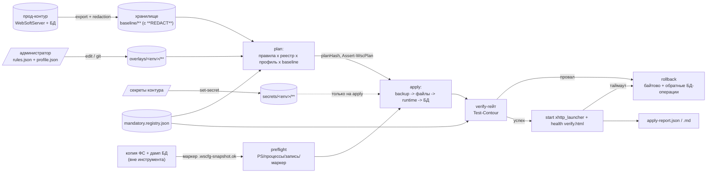

# Архитектура CI/CD переноса WebSoft HCM: prod -> preprod -> dev

Документ описывает архитектуру и принятые решения. Форматы файлов, сигнатуры функций и
коды выхода задаёт единственный источник истины — [`docs/CONTRACTS.md`](CONTRACTS.md).
Здесь изложено «почему так», а не «как именно в байтах».

Реализаций две (`impl/vault`, `impl/minio`), и они сознательно отличаются ровно одним
файлом — `store.ps1` (принцип D1 из CONTRACTS §6). Вся бизнес-логика команд живёт в
`core/lib/WscCfg.ps1` (`Invoke-WscCfg`).

## 1. Модель переноса: два независимых артефакта

Перенос контура — это ДВА разнородных артефакта, и они не перемешиваются:

| артефакт | что это | кто делает | роль инструмента |
|---|---|---|---|
| данные | копия файловой системы `WebSoftServer` + дамп/копия БД контура-источника | администратор / штатные средства бэкапа WebSoft, вне объёма этого инструмента | не копирует и не переносит |
| конфигурация | набор правил переноса, профиль контура, секреты | этот инструмент (`wscfg` + `bootstrap`) | компилирует план, применяет, проверяет, откатывает |

Инструмент проверяет данные **только по маркеру**: preflight требует существования
`.wscfg-snapshot.ok` в каталоге целевого контура (`impl/*/bootstrap.ps1`, функция
`Test-WscBootPreflight`). Нет маркера — `WSC_PREFLIGHT` (exit 2) и никаких записей. Это
сознательная граница: угадывать «достаточно ли свежий дамп» инструмент не вправе.

Конфигурация **никогда не переносится «как есть»**. Прод-значение может попасть в целевой
контур только через явное правило, поэтому у каждого переноса есть три слоя: снимок-эталон
(baseline), оверлей контура (rules + profile) и секреты. Именно отсутствие «как есть» —
главный смысл инструмента: протолкнуть прод-строку подключения в dev можно только сломано
написанным правилом, а не молча.

## 2. Модель хранения

Логические пути едины для обеих реализаций (CONTRACTS §6):

```
wscfg/v1/baseline/meta.json                  # когда, откуда, какие файлы, чего не было
wscfg/v1/baseline/files/<rel-path>           # текст прод-файла, секреты => **REDACTED**
wscfg/v1/baseline/db/<component>.<type>.json # снимок значений БД-настроек (без секретов)
wscfg/v1/overlays/<env>/rules.json           # правила контура-получателя
wscfg/v1/overlays/<env>/profile.json         # нечувствительные значения контура
wscfg/v1/secrets/<env>/<key>                 # секреты, отдельным слоем
```

- **baseline (prod, обезличенный).** Снимок прод-контура, из которого значения секретных
  целей заменены токеном `**REDACTED**` (`Export-WscBaseline`, CONTRACTS §8.1): маскируются
  поля реестра с `secret: true` и всё, что попадает под `Get-WscSensitivePattern`. Базлайн
  нужен не для применения, а для двух вещей: показать `oldValue` в плане (`diff`) и дать
  verify-гейту эталон «чего в контуре быть не должно».
- **overlay (контур).** `rules.json` + `profile.json` на каждый контур-получатель.
  Версионируется в git как редактируемый админом источник и синхронизируется с хранилищем
  командами `edit`/`export`. Профили живут **только** здесь — отдельного каталога
  `config/profiles/` в репозитории нет.
- **секреты — всегда отдельно.** Не в baseline, не в rules, не в git. В правиле хранится
  только имя секрета (`"secret": "db-password"`), значение приходит из хранилища в момент
  `apply` через `SecretResolver` (в `plan` — плейсхолдер `<secret:имя>`).

## 3. Канонические ссылки на цели

Одна строка описывает и файл, и объект БД, и манифест пакета (CONTRACTS §1):

| вид | формат | пример |
|---|---|---|
| JSON | `file:<rel>::json:<dot-path>` | `file:xhttp_config.json::json:Kestrel.EndPoints.Http.Url` |
| XML/XMD | `file:<rel>::xpath:<xpath>` | `file:spxml_unibridge_config.xml::xpath:/configuration/appSettings/add[@key='ConnectionString']/@value` |
| INI | `file:<rel>::ini:<KEY>` | `file:xHttp.ini::ini:DESIGN-DB` (дубли — полем `occurrence`) |
| резерв | `file:<rel>::regex:<pattern>` | только когда каналы выше не подходят |
| БД | `db:<comp>.<type>::<field-path>` | `db:websoft.aihub.ai_provider::endpoints[*].url` |
| пакет | `pkg:<component-dir>::<packageKey>` | `pkg:platform/aihub_mng@websoft.aihub::enabled` |

`Split-WscTargetRef` / `Format-WscTargetRef` идемпотентны, поэтому ссылка из плана, из
реестра и из правила — это один и тот же канон, и покрытие считается сравнением строк.

## 4. Порядок применения (bootstrap)

`impl/<x>/bootstrap.ps1` — оркестрация вокруг `Invoke-WscCfg`; порядок фиксирован:

| # | шаг | что происходит | код при провале |
|---|---|---|---|
| 1 | preflight | PS >= 5.1, каталог существует, серверные процессы остановлены, запись проверена пробником, маркер `.wscfg-snapshot.ok`, доступ к хранилищу на чтение | 2 `WSC_PREFLIGHT` (доступ — 7) |
| 2 | fetch + CAS | baseline (файлы/БД/`meta.json`/`prod-values.json`) + `rules.json`/`profile.json` из хранилища; версии читаются как основа CAS | 7 `WSC_STORE` |
| 3 | компиляция правил в план | `New-WscPlan`: правила × реестр × профиль × baseline -> `plan.json` + `plan.md`; гейт `Assert-WscPlan` | 3 `WSC_PLAN` |
| 4 | backup | байтовые копии затрагиваемых файлов в `<serverDir>/.wscfg-backup/<id>/files/...`, манифест с хешами | 4 `WSC_APPLY` |
| 5 | файлы | правки json/xpath/ini/regex, побайтово-бережливые, с ре-парсингом после правки | 4, авто-откат |
| 6 | runtime-переопределения | только `platform.runtime`/`components.runtime` (см. §6) | 4, авто-откат |
| 7 | БД-транзакция | `Open-WscDb` -> `Set-WscDbValue` -> `Submit-WscDb`, только по `id`, SELECT до и после | 4, откат транзакции |
| 8 | verify-гейт | `Test-Contour` по реестру; единственный общий гейт `apply` | 5 `WSC_VERIFY`, авто-откат |
| 9 | запуск + health | старт `xhttp_launcher.cmd/.exe`, проба `verify.html` в таймауте `-HealthTimeoutSec` | 6 `WSC_HEALTH`, откат |
| 10 | отчёт | `apply-report.json` / `apply-report.md`, `bootstrap.log` в `-OutDir` | — |

Повторный прогон даёт 0 изменений и exit 0 (идемпотентность): пункт с `newValue == oldValue`
остаётся в плане с `already = true` и в запись не превращается.

Шаги 9–10 — ответственность `bootstrap.ps1`. В общем слое `Invoke-WscCfg -Command apply`
запуск сервера и health-гейт **не** выполняются (флаг `-NoStart` там принимается, но ни на
что не влияет); для реального контура нужен именно `bootstrap.ps1`.

## 5. Потоки



## 6. Правило «не трогать подписанное»

Каталоги `platform/` и `components/` (а также `*_external/`) закрыты для записи **для всех
action без исключений**, включая `keep` и `manual`: компилятор плана отдаёт
`WSC_SIGNED_PATH` (exit 8), и то же самое проверяет verify-гейт `no_signed_files_touched`.
Конфигурация внутри подписанного компонента правке не подлежит — это подпись, и её порча
ломает поставку WebSoft, а не только пайплайн.

Отсюда — существование runtime-каталогов. Единственный легальный способ изменить поведение
компонента:

```
pkg:platform/aihub_mng@websoft.aihub::enabled -> platform.runtime/aihub_mng@websoft.aihub/package.runtime.json
```

и только по ключам `enabled`, `onFailure`, `roles`. Голый `<dir>` без префикса разрешается в
`components.runtime/`. В `mandatory.registry.json` и в оверлеях поэтому допустимы лишь
корневые файлы сервера, исключения `wt_data/**` и `db:`-цели.

## 7. Сравнение двух реализаций

| аспект | `impl/minio` (S3/MinIO) | `impl/vault` (KV v2) |
|---|---|---|
| версии/аудит | Versioning бакета обязателен; `versionId` непрозрачен, порядковый номер считается листингом `?versions` (+1 запрос) | целочисленная версия из коробки, `Get-WscStoreVersions`; поверх — штатный `audit device` |
| CAS | два независимых механизма: порядковая сверка `ExpectedVersion` + `x-amz-if-match` по ETag (сервер сам отвечает `412`) | `options.cas = <n>` — нативный, один запрос |
| политики на раннера | IAM-политика по префиксам + явный `Deny` на `secrets/prod/**` (Deny перекрывает Allow) | Vault-policies по путям + `deny` на `secret/data/wscfg/v1/secrets/prod/*`, AppRole на каждый контур |
| шифрование секретов | **обязательное клиентское envelope**: `age`, иначе AES-256-CBC (`WSCEF1:`); открытый текст в бакете — fatal на `validate` (`Assert-WscS3SecretsEncrypted`) | шифрование сервером, ключ не покидает Vault |
| неизменяемость baseline | Object Lock `COMPLIANCE` 30 дней — не снимет ни админ, ни root | неизменяемости нет, только история версий |
| эксплуатация | один контейнер, один бакет, отладка `aws s3`/`mc`, объект = файл | сервер + unseal + auth-методы + policies, KV неудобен для больших файлов |
| отзыв доступа | ротация ключа S3 | lease + мгновенная revoke |

Что **строже**: Vault — по секретам (ключ не выходит из сервера), по правам (гранулярность
и мгновенный отзыв), по аудиту (встроенный). Что **проще**: MinIO — меньше подвижных частей,
привычные S3-инструменты, нативная работа с конфиг-файлами и уникальная для него
юридически неизменяемая запись baseline. В MinIO строгость собирается руками: обязательное
клиентское шифрование + `Deny secrets/prod/**` + Object Lock + гейт «plaintext secret in
bucket». Замечание по AES-конверту: у него нет кода аутентичности (PKCS#7 вместо GCM),
подмена обнаруживается как ошибка расшифровки, но не как факт подмены — для строгой
аутентичности нужен `age`.

## 8. Реестр обязательных ключей — единственный источник истины verify-гейта

`config/mandatory.registry.json` (версия 1, **31 запись**) — перечень того, что в целевом
контуре обязано быть проверенным. Ни план, ни гейт не «догадываются», что важно: они
сверяют только то, что записано в реестре.

- Каждая запись: `key` (уникальный), `target` (каноническая ссылка), `check`
  (машиночитаемая проверка: `not_redacted`, `not_prod_value`, `not_empty`,
  `equals_profile:<dot-path>`, `regex:<pat>`, `port_match`, `no_cross_contour`),
  `file_optional`, `secret`, `optional_key`, `title`, `notes`.
- `wscfg validate` требует, чтобы каждый `key` был закрыт правилом с `mandatory: true` либо
  явным `waiver`-обоснованием; непокрытый ключ — exit 3.
- `Test-Contour` на `apply` выполняет проверку каждого `key` по `check` плюс сквозные
  проверки: `no_redacted`, `no_prod_value_leak`, `db_not_prod`, `mandatory_check`,
  `ports_match`, `allowed_hosts_match_profile`, `hosts_match_profile`, `cache_not_prod`,
  `rtc_no_collision`, `no_signed_files_touched`, `secrets_resolved`.

Как добавить ключ: добавить запись в `config/mandatory.registry.json`, добавить закрывающее
её правило в `config/overlays/<env>/rules.json`, выполнить `validate`, затем `plan` и
убедиться, что `coverage.missing` пуст. `wscfg scan` — **только помощник**: он перечисляет
кандидатов по чувствительным шаблонам и ничего не пишет в реестр; решение о том, что
считать обязательным, принимает администратор.

## 9. Безопасность

- **Секрет не попадает в git и в артефакты.** Правило хранит имя секрета; значение
  читается из хранилища только на `apply`. В baseline значения секретных целей заменены на
  `**REDACTED**`; `config/baseline/` (локальный кэш экспорта), `tests/out/` и
  `.wscfg-backup/` исключены из git, а `config/overlays/` намеренно не игнорируется.
- **«Раннер не читает прод-секреты».** Реализовано двумя слоями: политики хранилища
  (`deny` на `secrets/prod/*` в Vault, `Deny` в IAM у MinIO) и защита в глубине клиента —
  `Test-WscStoreAccess` и `Get-WscStoreSecret` при `Env='prod'` на чтение бросают
  `WSC_STORE` с текстом `prod secrets are not readable by runner`, даже если токен
  ошибочно дал доступ.
- **CAS против параллельных пайплайнов.** Запись оверлея и секрета передаёт прочитанную
  версию; несовпадение — `WSC_STORE` с текстом `cas conflict` и exit 7. Два администратора
  или два пайплайна не затирают друг друга молча. У Vault это `options.cas`, у S3 —
  порядковая сверка плюс `x-amz-if-match` по ETag.
- **Откат как часть модели, а не как опция.** Ошибка записи, провал verify-гейта и провал
  health-пробы одинаково ведут `Rollback-WscApply`: побайтовое восстановление файлов
  (включая удаление ранее не существовавших) и обратные БД-операции из `db[].undo`.

## 10. Ограничения и открытые вопросы

- Реальные Vault, MinIO, MSSQL и Postgres на стенде **не проверялись**: тесты подменяют
  единственную границу I/O (`Invoke-WscVaultApi`, `Invoke-WscS3Api`, `$ctx.SqlExecutor`).
  Не подтверждены живым сервером HTTP-коды Vault при CAS/404, разбор stdout `vault.exe`,
  реальный AppRole-логин, подпись SigV4 (`403 SignatureDoesNotMatch`), поведение
  `x-amz-if-match`/`x-amz-version-id`, Object Lock compliance.
- Имена таблиц aihub в SQL-драйверах **выводятся из XMD** и на исполнение подтверждаются
  по `information_schema`; сами имена без живого стенда не подтверждены.
- Порядок элементов массивов в SQL принят как `ORDER BY id`: у дочерних таблиц WebSoft нет
  порядковой колонки (комментарий в `core/db/DbMssql.ps1`, `DbPostgres.ps1` — «подтвердить
  на стенде»).
- `node_config.json` опционален: его отсутствие даёт WARNING (`optional_file`), а не ошибку.
- Реальные хосты контуров — **заглушки** в `config/overlays/*/profile.json`
  (`hcm-dev.local`, `dev-db.local`, `dev-redis.local` и т. п.), перед боем их нужно заменить.
- Advisory-lock (очередь «один промот на контур» на уровне СУБД или хранилища) **не
  реализован**: в коде нет ни `sp_getapplock`, ни аналога. Взаимная исключительность сейчас
  держится CAS (exit 7), транзакцией БД и ручным апрувом окружения в CI. Открытый вопрос.
- `diff` сравнивает только `file:`-цели; `db:`-цели в diff не входят.
- Общая нестыковка логирования: `WscRules` пишет уровень `WARNING`, а `Write-WscLog`
  принимает `DEBUG/INFO/WARN/ERROR`, поэтому компиляция плана вызывается без `-Log`.

## 11. Явные отклонения от плана

Зафиксированные отличия фактической реализации от первоначального плана — чтобы следующее
чтение плана не сбивало с толку:

1. **Вместо Pester 5 — собственный `tests/Harness.ps1`.** На машине есть только Pester
   3.4.0, который не поддерживает `Should -Be`, а Pester 5 установить нечем. Тесты пишутся
   на подмножестве API Pester 5 (`Describe`/`Context`/`It`/`BeforeAll`/`BeforeEach`/
   `AfterEach`/`AfterAll` и указанный набор `Should`-операторов), которое реализует harness
   и которое принимает настоящий Pester 5, если он появится. `tests/run-tests.ps1` сначала
   ищет Pester >= 5, при его отсутствии использует harness. `Mock`, `-TestDrive` и
   определения функций внутри `It` запрещены.
2. **Профили живут только в `config/overlays/<env>/profile.json`.** Каталога
   `config/profiles/` в репозитории нет и не предвидится: профиль контура — часть оверлея
   этого контура.
3. **Добавлено поле `optional_key`** (в правиле и в записи реестра): отсутствие ключа/цели
   в контуре даёт WARNING вместо `unresolved`. Не то же самое, что `optional_file`:
   `optional_file` решает судьбу отсутствующего файла, `optional_key` — отсутствующего
   ключа при существующем файле (например `DistributedCacheType`).
4. **План пишется шире схемы CONTRACTS §3**: кроме `items`, в `plan.json` есть `runtime`,
   `manualActions`, `coverage` и `ruleIndex`. `ruleIndex` нужен
   `Get-WscMandatoryCoverage -Plan` и в `planHash` не входит.
