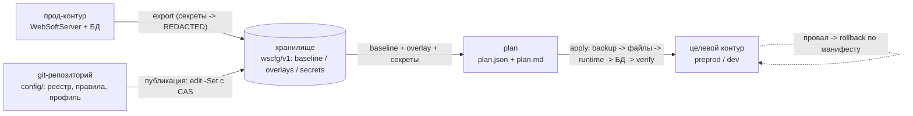
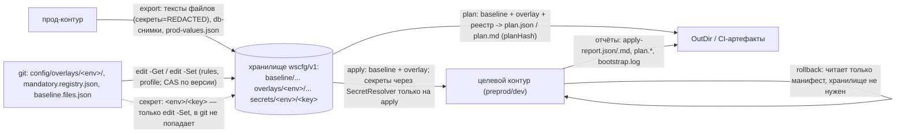
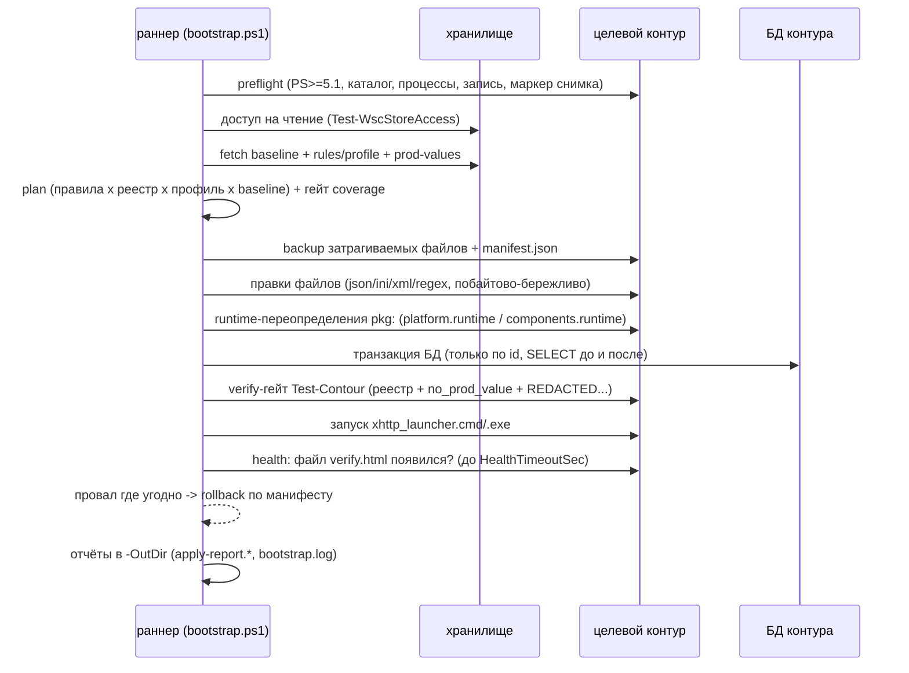

# PROCESS — наглядное руководство процессом переноса (для начинающего разработчика)

Этот документ — тонкий перессказ того, что уже является истиной в коде и других документах.
Единственный источник истины по форматам, сигнатурам и кодам выхода —
[`CONTRACTS.md`](CONTRACTS.md); если здесь и там разночтение, прав `CONTRACTS.md`.
Если вы администратор и видите инструмент впервые — начните с [`ADMIN-START.md`](ADMIN-START.md).
Схема процесса: основная линия — реализация на Vault (`impl/vault`), отличия реализации
MinIO (`impl/minio`) вынесены в выноски `> MinIO: ...`. Команды в примерах — Windows
PowerShell 5.1; пути контуров условные (`D:\WS\prod\WebSoftServer` и т.п.), как в
[`../README.md`](../README.md).

## 1. Что это и зачем

Инструмент `websoft-env-promotion` переносит **только конфигурацию** контура WebSoft HCM из
прода в preprod и dev. Данные (копия файловой системы + дамп БД) переносятся вне инструмента —
он лишь проверяет, что админ перенёс данные и поставил в корне контура маркер
`.wscfg-snapshot.ok` (для Vault-реализации; у MinIO маркер снимка ищется в хранилище, см. раздел 4).

Конфигурация никогда не переносится «как есть». Каждое изменение прода-значения описывается
**правилом контура**: «в dev этот ключ должен стать таким-то». Правила лежат в git и
опубликованы в хранилище, а незакрытые обязательные ключи реестра ломают пайплайн (exit 3) —
«забыли поменять прод-пароль в dev» физически не пройдёт verify-гейт.

Смысл разделения «данные отдельно, конфиг отдельно»: прод-данные — большая и медленная
часть, её переносят руками/штатными средствами, а конфиг — маленькая, но опасная часть
(прод-адреса, ключи, токены), и именно её инструмент делает проверяемой и повторяемой.

Работает это так: `export` снимает прод-конфиг в хранилище (секреты маскирует), `plan`
считает из правил разницу «прод -> целевой контур», `apply` применяет изменения к целевому
контуру с обязательным backup-манифестом и verify-гейтом, а при любом провале —
автоматический `rollback`. Всё, что делает админ руками, описано в разделах 4–6.



## 2. Словарь простыми словами

Этот раздел — перевод терминов на бытовой язык; точные форматы — `CONTRACTS.md`.

| термин | что это простым языком |
|---|---|
| контур | одна установка WebSoft HCM: каталог `WebSoftServer` + база данных + процессы. У нас три контура: prod (боевой), preprod, dev. |
| baseline | «слепок» прода: тексты прод-файлов и значения из БД, снятые `export` и сохранённые в хранилище. Секретные значения в нём заменены на `**REDACTED**`. |
| реестр | `config/mandatory.registry.json` — список из 31 обязательного ключа: «вот это в целевом контуре обязано быть проверено». Единственный источник истины verify-гейта (`ARCHITECTURE.md` §8). |
| правило | запись «что сделать с конкретным ключом в конкретном контуре»: подставить значение из профиля (`set`), оставить как есть (`keep`), взять секрет (`secret`) и т.п. |
| профиль | «ответы» контура: файл значений, которые правила подставляют вместо прод-значений (`config/overlays/<env>/profile.json`). |
| оверлей | пара `rules.json` + `profile.json` одного контура; живёт в git и публикуется в хранилище через `edit`. |
| секрет | значение, которого никогда не бывает в git и в baseline (токены, пароли). Хранится по пути `wscfg/v1/secrets/<env>/<key>`, пишется только командой `edit`. |
| `**REDACTED**` | маска секретного значения в baseline. В отчётах и baseline — норма; если осталась в контуре после `apply` — verify-гейт не пропустит (exit 5). |
| verify-гейт | финальная проверка прямо внутри `apply`: каждый ключ реестра по его `check` плюс сквозные проверки (нет прод-подстрок, нет `**REDACTED**`, секреты прочитаны...). Провал — авто-откат, exit 5. |
| план / planHash | `plan.json` + `plan.md` — посписочный «что изменится и почему». `planHash` — sha256-хеш канонического плана; одинаковые входы дают одинаковый хеш (детерминированность). |
| coverage.missing | поле плана: какие ключи реестра НЕ закрыты ни правилом, ни waiver. Пусто — хорошо; непусто — план не проходит гейт (exit 3). |
| манифест | `manifest.json` в `<ServerDir>\.wscfg-backup\<id>\` — «что тронули и где лежат backup-копии». Нужен только для `rollback`. |
| rollback | откат по манифесту: побайтовое восстановление файлов + обратные БД-операции. Хранилище для отката не нужен. |
| хранилище | место, где живут baseline, оверлеи и секреты: HashiCorp Vault (KV v2) или MinIO (S3). Логические пути `wscfg/v1/...` у обеих реализаций одинаковые. |
| CAS | compare-and-swap: запись в хранилище «только если версия всё ещё та» (`-ExpectedVersion`). Не совпало — exit 7, `cas conflict`. Спасает, когда два админа правят оверлей одновременно. |
| идемпотентность | повторный прогон ничего не меняет: `apply` ещё раз даёт 0 изменений и exit 0; `export` неизменённого файла не создаёт новую версию. |
| фикстурный контур | игрушечная копия контура в `tests/fixture/`, на которой тесты гоняют весь путь export -> plan -> apply -> rollback без настоящих серверов. |

## 3. Кто с кем общается: информационные потоки

Здесь нарисовано, какие данные текут между продом, git, хранилищем, целевым контуром и
артефактами — и в какую сторону.



| поток | что несёт | куда попадает |
|---|---|---|
| `export` | тексты прод-файлов (секретные цели — `**REDACTED**`), снимки `db:`-значений, `prod-values.json` (список прод-маркеров) | `wscfg/v1/baseline/...` + локальный кэш `config/baseline/` |
| `edit -Get` / `edit -Set` | `rules.json` и `profile.json` из git — в хранилище, с CAS по версии | `wscfg/v1/overlays/<env>/...` |
| `edit` секрета | одно значение секрета (в git не попадает никогда) | `wscfg/v1/secrets/<env>/<key>` |
| `plan` | baseline + оверлей + реестр -> список изменений | `plan.json` + `plan.md` в `-OutDir`, `planHash` |
| `apply` | план -> файлы контура -> runtime (`pkg:`) -> БД; ДО правок — backup и манифест | контур + `<ServerDir>\.wscfg-backup\<id>\manifest.json` |
| `rollback` | только манифест (хранилище не нужен) | побайтно восстановленные файлы + обратные БД-операции |
| отчёты | `plan.json`, `plan.md`, `apply-report.json`, `apply-report.md`, `bootstrap.log` | `-OutDir` -> CI artifact |

## 4. Установка и подготовка (делается один раз)

Этот раздел — чек-лист «поставить и настроить», чтобы дальше только гонать пайплайн.

1. **Машина/раннер.** Windows с PowerShell **5.1** (`powershell.exe`) — preflight требует
   версию ≥ 5.1 (`impl/vault/bootstrap.ps1:106-109`). Нужен `git` и клон репозитория.
   Точки входа — обычные `.ps1`, никакой установки пакетов нет.

2. **Хранилище — Vault.** Сервер Vault с KV v2 (mount `secret`), все данные под префиксом
   `wscfg/v1` (пути — [`../impl/vault/layout.md`](../impl/vault/layout.md)). Создаются две
   политики — `wscfg-runner` (раннер **не** читает прод-секреты: явный `deny` плюс защита в
   глубине `store.ps1`) и `wscfg-admin` (экспорт baseline, публикация оверлеев). Готовый HCL
   не копируем сюда — он в [`../impl/vault/layout.md`](../impl/vault/layout.md) (раздел
   «Политики»). На каждый контур заводится своя AppRole: `RoleId` — в `StoreConfig`-файл,
   `SecretId` — только в секреты CI. Транспорт: `vault.exe` (env `VAULT_ADDR`/`VAULT_TOKEN`)
   либо REST — это JSON-файл, который передаётся параметром `-StoreConfig <json>`.

   > **MinIO:** вместо Vault — бакет `websoft-configs` с включённым Versioning; параметры
   > хранилища задаются флагами `-Endpoint -Bucket -Region -Prefix -AccessKey -SecretKey`
   > (или `-SecretKeyFile`; в CI — секреты `MINIO_*`). Секреты **обязано** шифровать на
   > клиенте (age или AES, конверт `WSCEF1:`) — файл ключа `SecretKeyFile` живёт вне git;
   > открытый пароль в бакете валит пайплайн ещё до первого `apply`
   > ([`../impl/minio/layout.md`](../impl/minio/layout.md)).

3. **Фейковый режим для обучения и тестов.** Живое хранилище не обязательно: передайте
   `-StoreRoot <каталог>` — и тот же код работает поверх файлового фейка
   (`core/lib/WscStoreFake.ps1`).

   > **MinIO:** у фейка два пути: `-StoreRoot <каталог>` или `-Transport fake`
   > (по умолчанию транспорт `rest`).

4. **CI (Gitea Actions).** Нужен windows-раннер с `pwsh`. Workflow:
   [`../impl/vault/pipeline/gitea-promote-prod-to-preprod.yml`](../impl/vault/pipeline/gitea-promote-prod-to-preprod.yml).
   Ручной апрув — `environment` `<env>` с required reviewer в настройках Gitea
   (Settings -> Environments -> Deployment protection rules; в yml это строка
   `environment: ${{ matrix.env }}`). В секреты CI кладутся `VAULT_ADDR` (Vault) или
   `MINIO_*` (MinIO) и `SecretId`/`SecretKey`; путь контура задаётся переменной
   `WSC_SERVER_DIR_<ENV>` (`WSC_SERVER_DIR_PREPROD`, `WSC_SERVER_DIR_DEV`); если она пуста —
   input `server_dir`, иначе fallback `contours\<env>\WebSoftServer`.

   > **MinIO:** другой workflow
   > ([`../impl/minio/pipeline/gitea-promote-prod-to-preprod.yml`](../impl/minio/pipeline/gitea-promote-prod-to-preprod.yml)):
   > два job (`plan` -> `apply`), а апрув — не environment, а явный input-параметр: step
   > требует точную строку `APPROVE-<env>`, иначе exit 9. Пути контуров — env
   > `WSC_PROD_SERVER_DIR` / `WSC_TARGET_SERVER_DIR`.

5. **Требования к целевому контуру** (preflight их проверит сам, лучше прочитать заранее):
   - процессы `xhttp_64` / `xhttp_launcher` / `dotnetcore` остановлены;
   - в каталог контура можно писать (preflight пишет и удаляет probe-файл
     `.wscfg-probe-<guid>.tmp`);
   - в **корне каталога контура** лежит маркер `.wscfg-snapshot.ok` — его ставит админ после
     переноса данных (копии ФС + дампа БД);
   - в корне есть `xhttp_launcher.cmd` (или `xhttp_launcher.exe`) — чем bootstrap поднимет сервер;
   - health-проба: после запуска в корне контура должен **появиться файл `verify.html`** —
     это проверка существования файла (`Test-Path`), а НЕ http-запрос; ждать до
     `-HealthTimeoutSec` (по умолчанию 120 с). См. `impl/vault/bootstrap.ps1:134-160` и FAQ.

   > **MinIO:** preflight другой: проверяет комплектность контура (`xHttp.ini`,
   > `spxml_unibridge_config.xml`), ≥200 МБ свободного места на диске, наличие
   > `rules.json`/`profile.json` оверлея на диске и маркер снимка **в хранилище**
   > (`wscfg/v1/baseline/meta.json`); имена останавливаемых процессов задаются параметром
   > `-ServerProcessNames`. Health по умолчанию тоже файловый, но ищет `wt\web\verify.html`
   > (или `webDir` из профиля) и корневой `verify.html`; опционально можно включить
   > HTTP-пробу параметром `-HealthUrl`. Таймаут по умолчанию 60 с (workflow передаёт 120).

## 5. Настройка один раз: правила, реестр, профиль, секреты

Здесь показано, как связаны реестр -> правило -> профиль -> секрет, на одном живом
не-секретном и одном секретном примере.

Возьмём ключ `aihub.CredentialsBaseUrl` (базовый URL AI-провайдера в таблице БД):

1. **Реестр** (`config/mandatory.registry.json`) говорит, что проверить: запись
   `key: "aihub.CredentialsBaseUrl"`, `target: "db:websoft.aihub.ai_credentials::base_url"`,
   `check: "not_prod_value"` — «в целевом контуре тут не должно быть прод-значения».
2. **Правило** (`config/overlays/dev/rules.json`) говорит, чем закрыть: правило
   `id: "aihub-credentials-base-url"` с `action: "set"` и
   `fromProfile: "aihub.baseUrl"` — «подставь значение из профиля контура».
3. **Профиль** (`config/overlays/dev/profile.json`) даёт само значение:
   `aihub.baseUrl = "https://ai-dev.local/v1"`.

Цепочка секретного примера — `aihub.CredentialsToken`: правило `aihub-credentials-token`
имеет `action: "secret"` и `secret: "dev__aihub_credentials_token"` — это только **имя**
секрета. Значение токена существует лишь в хранилище (`wscfg/v1/secrets/dev/...`) и
читается оттуда ровно один раз — во время `apply`; в план, baseline, git и артефакты оно не
попадает никогда.

Публикация правил/профилей в хранилище — через `edit`, с чтением текущей версии (она нужна
для CAS):

```powershell
# прочитать правила из хранилища: вернёт Text и Version
powershell -NoProfile -ExecutionPolicy Bypass -File impl\vault\wscfg.ps1 -Command edit `
  -Env dev -Item rules -Get -StoreConfig "C:\secrets\wscfg-vault-dev.json" -Json

# отредактировать config/overlays/dev/rules.json в git, затем опубликовать с CAS:
# -ExpectedVersion = Version из предыдущего -Get; не совпало -> exit 7 (кто-то успел раньше)
powershell -NoProfile -ExecutionPolicy Bypass -File impl\vault\wscfg.ps1 -Command edit `
  -Env dev -Item rules -Set -SourceFile ".\config\overlays\dev\rules.json" `
  -ExpectedVersion 4 -StoreConfig "C:\secrets\wscfg-vault-dev.json"
```

Первый прогон подготовки: `export` прод-снимка (нужен доступ к прод-машине, см. раздел 6) и
`validate` — он проверяет схему правил и покрытие реестра **без хранилища** (правила читаются
из `config/overlays/`). Секреты на каждый контур заводятся до первого `apply` — иначе
`apply` упадёт на нерешённом секрете.

> **MinIO:** те же команды, только вместо `-StoreConfig` — `-Endpoint -Bucket -AccessKey
> -SecretKey` (или `-Transport fake -StoreRoot .\store` для тренировки). Запись секрета
> MinIO всегда шифрует такую запись (см. раздел 4).

## 6. Как администратор работает каждый день

Раздел-рецепт: пять типовых ситуаций и команды для обеих реализаций.

**1) Штатный прогон — вообще без ручных команд: запуск workflow по кнопке.**
Vault-workflow делает 5 шагов на каждый контур (matrix `[preprod, dev]`):
`1) export` -> `2) preflight (-DryRun -NoStart)` -> `3) dry-run (-DryRun)` -> **ручной
апрув (environment required reviewer)** -> `4) apply + start + health (-HealthTimeoutSec
180)` -> `5) upload-artifact` (plan.json / plan.md / apply-report.json / apply-report.md /
bootstrap.log). Смотреть: лог шага 4 и артефакт `wscfg-<env>-report`.

> **MinIO:** job `plan` (snapshot -> preflight -> dry-run -> upload plan), затем job `apply`
> с шагом ручного апрува: перезапустить workflow с input `approve=APPROVE-<env>`; шаг
> `apply` идёт с `-NoStart`, запуск+health отдельным шагом `-StartOnly`. Артефакты:
> `apply-report.json/.md`, `bootstrap-report.json`, `manifest-*.json`.

**2) Ручной путь (или разбор провала пайплайна):**

```powershell
# снять свежий прод-снимок (Vault; для живой Vault вместо -StoreRoot свой -StoreConfig)
powershell -NoProfile -ExecutionPolicy Bypass -File impl\vault\wscfg.ps1 -Command export `
  -SourceServer "D:\WS\prod\WebSoftServer" -StoreRoot ".\store"
# что поехало относительно baseline:
powershell -NoProfile -ExecutionPolicy Bypass -File impl\vault\wscfg.ps1 -Command diff `
  -ServerDir "D:\WS\dev\WebSoftServer" -StoreRoot ".\store"
# схема правил + покрытие реестра (хранилище не нужен):
powershell -NoProfile -ExecutionPolicy Bypass -File impl\vault\wscfg.ps1 -Command validate -Env dev
# план: прочитать plan.md, убедиться что coverage.missing пуст:
powershell -NoProfile -ExecutionPolicy Bypass -File impl\vault\wscfg.ps1 -Command plan `
  -Env dev -ServerDir "D:\WS\dev\WebSoftServer" -OutDir ".\out\dev" -StoreRoot ".\store"
# применить (запуск сервера — только на bootstrap):
powershell -NoProfile -ExecutionPolicy Bypass -File impl\vault\wscfg.ps1 -Command apply `
  -Env dev -ServerDir "D:\WS\dev\WebSoftServer" -OutDir ".\out\dev" -StoreRoot ".\store"
```

> **MinIO:** те же команды на `impl\minio\wscfg.ps1`, параметры хранилища —
> `-Endpoint "https://minio.local" -AccessKey $env:WSC_S3_AK -SecretKey $env:WSC_S3_SK`
> (или `-Transport fake -StoreRoot ".\store"`).

Смотреть: `.\out\dev\plan.md` (что сделает), `apply-report.md` (что сделало, `rolledBack`).

**3) «Появился новый ключ»** — ровно так, как он добавлялся в репозиторий: записать ключ в
`config/mandatory.registry.json` (с `check`), добавить закрывающее правило с
`mandatory: true` в `config/overlays/<env>/rules.json` каждого контура, опубликовать правила
через `edit -Set`, затем `validate` -> `plan` -> `apply`. Ассерты тестов ловят рассинхрон
счётчиков. Пока ключ не закрыт правилом — `validate`/`plan` дадут exit 3, и это правильно.

**4) «Изменилось значение существующего ключа»** — не трогая правил: нечувствительное
значение правится в `config/overlays/<env>/profile.json` (и публикуется `edit -Set`),
секрет — только `edit -Item secret:<key> -Set -Value ...`.

**5) «Контур поднялся криво»** — откат по манифесту из `apply-report.md` (строка
`manifest`), хранилище не нужен:

```powershell
powershell -NoProfile -ExecutionPolicy Bypass -File impl\vault\wscfg.ps1 -Command rollback `
  -Manifest "D:\WS\dev\WebSoftServer\.wscfg-backup\<id>\manifest.json" `
  -ServerDir "D:\WS\dev\WebSoftServer"
```

Смотреть: вывод `rollback` и статус `rolledBack` в манифесте (раздел 9).

## 7. Что происходит внутри автоматически

Это детальный разбор одного прогона `bootstrap.ps1` — от preflight до отчёта.



ASCII-версия главного пайплайна (читается без рендера):

```
export(прод) -> [preflight] -> [fetch baseline+overlay+секреты] -> [plan + гейт]
                    |2               |7                              |3 (coverage.missing /
                    v                v                               v  неразрешённое правило)
              стоп, чинить окружение                         план в -OutDir (plan.json/.md)
                                                                    |
   [apply: backup -> файлы -> runtime(pkg:) -> БД -> verify-гейт] <-'
                    |4 (запись) / |5 (verify; авто-rollback)
                    v
   [start xhttp_launcher -> health verify.html <= HealthTimeoutSec]
                    |6 (таймаут -> авто-rollback)
                    v
   [отчёты: apply-report.json/.md + bootstrap.log -> OutDir -> CI artifact]  exit 0
```

Таблица стадий (для `impl/vault/bootstrap.ps1`; порядок — `ARCHITECTURE.md` §4,
`impl/vault/layout.md`):

| стадия | вход | выход / что делает | артефакт | код при провале |
|---|---|---|---|---|
| preflight | `-ServerDir`, хранилище | PS≥5.1, каталог есть, серверные процессы остановлены, запись пробником возможна, маркер `.wscfg-snapshot.ok`, чтение хранилища | строки в `bootstrap.log` | 2 `WSC_PREFLIGHT`; доступ к хранилищу — 7 |
| fetch | хранилище | rules/profile (обязательны), baseline (файлы+db+meta), `prod-values.json` (best-effort) | — | 7 `WSC_STORE` |
| plan + гейт | правила × реестр × профиль × baseline | компиляция плана, `Assert-WscPlan`: неразрешённые правила / непустой `coverage.missing` не пропускаем | `plan.json`, `plan.md` (planHash) | 3 `WSC_PLAN` |
| apply | план | backup+манифест -> файлы -> runtime (`pkg:`) -> БД-транзакция -> verify-гейт; провал verify = авто-rollback | `.wscfg-backup\<id>\`, `apply-report.json/.md` | 4 `WSC_APPLY`, 5 `WSC_VERIFY` |
| start + health | launcher | старт `xhttp_launcher.cmd`/`.exe`; ждать файл `verify.html` до `-HealthTimeoutSec`; таймаут = `Rollback-WscApply` + ошибка | строки health в логе | 6 `WSC_HEALTH` |
| отчёт | лог + результаты | запись отчётов и лога | `apply-report.*`, `bootstrap.log` в `-OutDir` | — |

Важные переключатели: `-DryRun` = preflight + fetch + plan, никаких записей; `-NoStart` =
без запуска сервера (в CI применяется на разминочных шагах); повторный полный прогон даёт
**0 изменений и exit 0** (идемпотентность). В текущем фикстурном контуре реестр 31 ключ,
план — 60 items, verify-гейт — 41 проверка, штатный apply — 17 изменений (цифры из
`tests/out/integration-vault.md`; в коде они не захардкожены).

> **MinIO:** свой `impl/minio/bootstrap.ps1` с дополнительными переключателями: `-Snapshot`
> (снять baseline прямо в прогоне, нужен `-SourceServer`), `-SkipPreflight`, `-SkipValidate`,
> `-StartOnly` (только запуск+health — так делает её workflow), `-Manifest`; health умеет и
> файловый режим, и HTTP (`-HealthUrl`).

## 8. Коды выхода и что делать

Все коды — из таблицы CONTRACTS §0.1 (там же полные определения); здесь — «первое действие»
для новичка.

| exit | почему | первое действие |
|---|---|---|
| 0 | успех, включая «0 изменений» (идемпотентность) | ничего, читать `apply-report.md` при желании |
| 2 | preflight: нет каталога / процессы запущены / нет записи / нет маркера снимка | читать сообщение `[WSC_PREFLIGHT]`: остановить сервер контура, перенести данные и поставить `.wscfg-snapshot.ok` (Vault) или снять `-Snapshot`/`export` (MinIO) |
| 3 | plan: правило не разрешилось, покрытие реестра не закрыто (`coverage.missing`), неверная схема правила | читать `plan.md`: добавить закрывающее правило (или waiver), `validate`, заново |
| 4 | apply: ошибка записи файла/БД (откат уже выполнен) | разбор `apply-report.md` + `bootstrap.log`; контур в исходном состоянии |
| 5 | verify-гейт: в контуре осталось прод-значение / `**REDACTED**` / непройденная проверка реестра (авто-откат выполнен) | смотреть список упавших проверок в `apply-report.md`; править профиль/секрет, не гейт |
| 6 | health: сервер не поднялся за таймаут (авто-откат выполнен) | проверить `xhttp_launcher`, логи сервера; увеличить `-HealthTimeoutSec` только если сервер реально медленный |
| 7 | хранилище: недоступно / аутентификация / CAS-конфликт / NOTFOUND | CAS-конфликт: `edit -Get` заново (новая Version), влить свои правки, публиковать с новым `-ExpectedVersion`; иначе — проверка токена/эндпоинта |
| 8 | попытка таргета внутрь подписанного (`platform/`, `components/`) | убрать правило; легальный путь — `pkg:` в `platform.runtime`/`components.runtime` |
| 9 | неверные аргументы CLI | сравнить команду с таблицей входов README / разделом 13 |

## 9. Откат по шагам

Откат — штатная часть модели, а не аварийная процедура; он нужен редко, но знать его надо.

1. Найти манифест. Каждый `apply` создал каталог
   `<ServerDir>\.wscfg-backup\<id>\` с побайтовыми копиями затронутых файлов и
   `manifest.json` (с хешами и обратными БД-операциями `db[].undo`). Путь манифеста печатается
   в `apply-report.md`.
2. Остановить процессы контура (если подняли кривой контур).
3. Выполнить rollback — **только** `-Manifest` (обязателен), `-ServerDir` опционален
   (читается из манифеста), хранилище не нужен — одинаково на обоих входах:

```powershell
powershell -NoProfile -ExecutionPolicy Bypass -File impl\minio\wscfg.ps1 -Command rollback `
  -Manifest "D:\WS\dev\WebSoftServer\.wscfg-backup\<id>\manifest.json"
```

4. Что восстановится: побайтово все затронутые файлы (включая **удаление** тех, которых до
   apply не было) + обратные БД-операции из манифеста. На фикстуре это 18 файлов.
5. Как выглядит: статус манифеста становится `rolledBack`; провальные авто-откаты
   (verify/health) помечают это в `apply-report` — там же можно прочитать, что именно
   откатился и почему.
6. Проверить себя: diff контура с ожидаемым «до»-состоянием, `diff`-команда против baseline.

## 10. Информационные потоки — полная таблица

Полная «таблица потоков» по всем данным, которые ходят между узлами процесса.

| откуда | куда | что | формат / место | кто пишет | кто читает |
|---|---|---|---|---|---|
| прод-контур | хранилище | тексты файлов baseline (секретные цели — `**REDACTED**`) | `wscfg/v1/baseline/files/<rel>` | `export` (админ) | `plan`, `diff` (раннер) |
| прод-контур (БД) | хранилище | снимки `db:`-значений (без секретов) | `wscfg/v1/baseline/db/<comp>.<type>.json` | `export` | `plan` |
| прод-контур | хранилище | плоский список прод-маркеров для гейта | `wscfg/v1/baseline/prod-values.json` | `export`/админ | verify-гейт (best-effort) |
| прод-контур | хранилище | метаданные снимка (когда/откуда/что) | `wscfg/v1/baseline/meta.json` | `export` | preflight (MinIO), `plan` |
| git (`config/overlays`) | хранилище | правила и профиль контура | `wscfg/v1/overlays/<env>/rules.json`/`profile.json`, версии + CAS | `edit -Set` (админ) | `plan`/`apply` (раннер, только read) |
| админ | хранилище | одно секретное значение | `wscfg/v1/secrets/<env>/<key>` (Vault KV / MinIO — только шифр) | `edit` (админ) | `apply` через SecretResolver (раннер — только свой env) |
| plan | OutDir | план изменений + хеш | `plan.json` (`planHash`), `plan.md` | `plan` | админ, CI artifact |
| apply | контур + диск | backup-копии до правок | `<ServerDir>\.wscfg-backup\<id>\` + `manifest.json` | `apply` | `rollback` |
| apply | OutDir | итоговый отчёт | `apply-report.json`, `apply-report.md` | `apply`/bootstrap | админ, CI artifact |
| bootstrap | OutDir | лог прогона | `bootstrap.log` (Vault) / `bootstrap-report.json` (MinIO) | bootstrap | админ, CI artifact |
| CI | артефакты | всё выше + манифесты | `wscfg-<env>-report` / `apply-report-<env>` | `upload-artifact` | админ после прогона |
| тесты | `tests/out/` | результаты прогона (git-ignored) | `junit.xml`, `test-results.json`, `integration-*.md` | `run-tests.ps1`, `Run-FullScenario.ps1` | разработчик |

## 11. Механизмы безопасности простыми словами

Каждый пункт закрывает конкретную беду, а не «безопасность вообще».

- **Раннер не читает прод-секреты.** Два слоя: политика хранилища (Vault `deny` на
  `secrets/prod/*`; MinIO явный `Deny` в IAM — Deny перекрывает любые Allow) и защита в
  глубине клиента: `Test-WscStoreAccess`/`Get-WscStoreSecret` при `Env='prod'` на чтение
  бросают ошибку, даже если токен ошибочно дал доступ.
- **CAS против двух админов.** Запись оверлея/секрета с `-ExpectedVersion`: если версия
  изменилась, запись отклоняется (exit 7, `cas conflict`) — чужие правки не затираются молча.
  У Vault это нативный `options.cas`, у S3 — сверка версии + `x-amz-if-match` по ETag.
- **Подписанное не тронуть.** Таргеты внутрь `platform/` и `components/` запрещены для всех
  action (exit 8). Единственный легальный способ повлиять на компонент — `pkg:`-правило в
  `platform.runtime`/`components.runtime/<dir>/package.runtime.json` и только ключи
  `enabled`, `onFailure`, `roles`.
- **Verify-гейт ловит прод-утечку.** Проверка `not_prod_value` по реестру + сквозные
  `no_prod_value_leak` / `cache_not_prod` / `no_redacted`: прод-хосты, прод-строки и маски
  `**REDACTED**` не останутся в целевом контуре — иначе exit 5 и авто-откат.
- **Секретов в baseline не бывает.** Export маскирует секретные цели, в git секретные значения
  не попадают (`config/baseline/` и `tests/out/` игнорируются), правило хранит только имя секрета.
- **Ручной апрув в CI.** Между dry-run и apply стоит человек: environment required reviewer
  (Vault-workflow) или явная строка `APPROVE-<env>` (MinIO-workflow).
- **Идемпотентность.** Повторный `apply` ничего не пишет (0 изменений, exit 0), `export`
  неизменённого файла не создаёт версию — прогон «на всякий случай» безопасен.
- > **MinIO дополнительно:** секреты шифруются **на клиенте всегда** (age/AES `WSCEF1:`),
  открытый текст в бакете — fatal (`plaintext secret in bucket`) ещё на validate; ключ
  шифрования живёт только в `SecretKeyFile` вне бакета; baseline защищён Object Lock
  (compliance) — «подкрутить снимок под план» не выйдет; у бакета обязателен Versioning.

## 12. Частые вопросы новичка / типовые ошибки

**Q: У меня exit 2. Что сломано?**
A: Это preflight — окружение, а не конфиг. В сообщении после `[WSC_PREFLIGHT]` причина: нет
каталога контура, запущен `xhttp_64`/`xhttp_launcher`/`dotnetcore`, нет права на запись, нет
маркера `.wscfg-snapshot.ok` в корне контура (Vault). Чинится на машине контура, не в git.

**Q: Откуда взять StoreConfig?**
A: Это JSON с параметрами подключения к Vault (транспорт, адрес, токен или `RoleId`), его
готовит админ Vault; кладётся на раннер, в git не попадает. Для обучения он не нужен вовсе:
`-StoreRoot <каталог>` — и работает файловый фейк.

**Q: Что такое planHash и зачем сверять `vault == minio`?**
A: Детерминированный sha256 плана: одинаковые baseline/правила/профиль/реестр -> одинаковый
хеш на любой реализации хранилища. Если план Vault и план MinIO дали разные `planHash`,
значит реализации разошлись в данных — это регрессия (интеграционный прогон как раз сверяет
их: planHash идентичен).

**Q: В baseline/отчёте написано `**REDACTED**` — это баг?**
A: Нет, это норма маскировки секрета **в baseline**. Баг — если `**REDACTED**` остался в
**целевом контуре** после apply: verify-гейт этого не пропустит (exit 5).

**Q: Можно ли править rules.json руками прямо в хранилище/на сервере?**
A: Нет. Порядок: git (`config/overlays/<env>/rules.json`) -> `edit -Set` с CAS. Правка,
сделанная «на сервере», не видна в git, не аудируется и будет затёрта следующей публикацией.

**Q: Почему нельзя писать в `platform/`?**
A: Это подписанные компоненты, правка ломает подпись. План отвергает такие таргеты (exit 8);
разрешено только переопределение `pkg:`-ключей `enabled`/`onFailure`/`roles` в
`platform.runtime`/`components.runtime`.

**Q: Как потренироваться без Vault и MinIO?**
A: Файловый фейк: `-StoreRoot <каталог>` на любом входе (minio — ещё `-Transport fake`);
полный сквозной путь на фикстурном контуре —
`powershell -NoProfile -ExecutionPolicy Bypass -File tests/integration/Run-FullScenario.ps1 -Impl both`.

**Q: Как проверить себя перед пушем?**
A: `powershell -NoProfile -ExecutionPolicy Bypass -File tests/run-tests.ps1` (все 479
проверок) и `Run-FullScenario.ps1 -Impl both` (сквозной путь: export -> diff -> plan ->
apply -> повторный apply -> rollback с проверкой кодов выхода).

**Q: План успешен, но сервер не запустился — это ба?**
A: Нет. Запуск сервера и health-проба — только ответственность `bootstrap.ps1`; у
`Invoke-WscCfg -Command apply` запуска нет (`-NoStart` на apply ни на что не влияет). Для
полного прогона запускайте bootstrap.

**Q: Health-проба ходит по http на verify.html?**
A: Нет. Vault-реализация просто ждёт, когда в корне контура **появится файл** `verify.html`
(`Test-Path`, каждые 250 мс, до `-HealthTimeoutSec`, по умолчанию 120 с). HTTP-запросов нет;
у MinIO HTTP-проба возможна, но только если явно задан `-HealthUrl`.

**Q: Получил exit 7 `cas conflict` — всё пропало?**
A: Нет — кто-то опубликовал оверлей раньше вас. `edit -Get` (получите новую `Version`),
перепубликуйте свою версию файла с новым `-ExpectedVersion`.

## 13. Мини-справочник

Быстрые ссылки и таблицы; подробности — по ссылкам, не дублируем.

| вход | что это | ключевые параметры |
|---|---|---|
| `impl/vault/wscfg.ps1` | тонкий вход Vault (все команды) | `-Command`, общие параметры; `-StoreConfig <json>` (живое), `-StoreRoot <каталог>` (фейк) |
| `impl/minio/wscfg.ps1` | тонкий вход MinIO/S3 (те же команды) | без `-StoreConfig`; `-Transport rest|fake`, `-Endpoint -Bucket -Region -Prefix -AccessKey -SecretKey[-SecretKeyFile]` |
| `impl/vault/bootstrap.ps1` | оркестрация контура (Vault) | `-ServerDir -Env -StoreConfig|-StoreRoot -DryRun -NoStart -OutDir -HealthTimeoutSec` (по умолч. 120) |
| `impl/minio/bootstrap.ps1` | оркестрация контура (MinIO) | те же + `-Snapshot -SkipPreflight -SkipValidate -StartOnly -Manifest -HealthUrl -Launcher -ServerProcessNames`; `-HealthTimeoutSec` по умолч. 60 |
| `impl/vault/bootstrap.cmd` / `.sh` | обёртки bootstrap (cmd — PS 5.1; sh — CI с pwsh) | пробрасывают параметры как есть |

Минимум по командам (детали — README, «Реализации и точки входа»): `export` — хранилище +
`-SourceServer`; `diff` — `-ServerDir` + хранилище или `-Against`; `edit` — хранилище +
`-Env -Item`; `validate` — только `-Env`; `plan`/`apply` — `-Env -ServerDir` + хранилище;
`rollback` — только `-Manifest`; `scan` — только `-ServerDir`.

Структура репозитория — таблица в [`../README.md`](../README.md) («Структура репозитория»):
`config/` (реестр, baseline.files.json, overlays), `core/lib` (вся логика), `core/db`,
`impl/vault`, `impl/minio`, `tests/`, `docs/`.

Дальше читать:
- [`CONTRACTS.md`](CONTRACTS.md) — форматы, сигнатуры, коды выхода (источник истины);
- [`ARCHITECTURE.md`](ARCHITECTURE.md) — модель, потоки, порядок bootstrap, сравнение Vault/MinIO;
- [`../impl/vault/layout.md`](../impl/vault/layout.md) — пути в хранилище, политики HCL, AppRole, CAS;
- [`../impl/minio/layout.md`](../impl/minio/layout.md) — бакет, версии/Object Lock, шифрование секретов, IAM;
- [`../impl/vault/pipeline/gitea-promote-prod-to-preprod.yml`](../impl/vault/pipeline/gitea-promote-prod-to-preprod.yml) и
  [`../impl/minio/pipeline/gitea-promote-prod-to-preprod.yml`](../impl/minio/pipeline/gitea-promote-prod-to-preprod.yml) — пайплайны CI;
- [`../README.md`](../README.md) — быстрый старт и ручные рецепты администратора.
